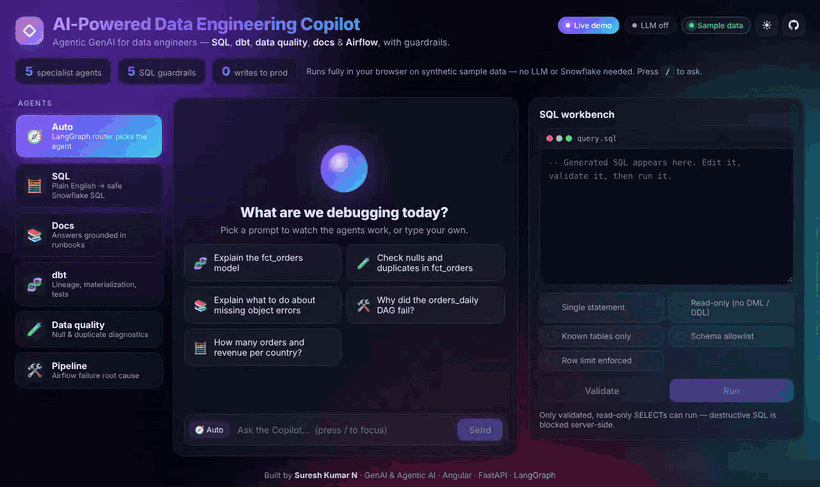
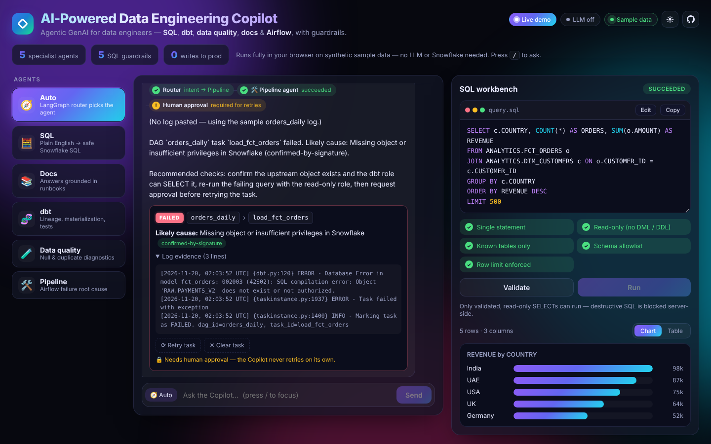
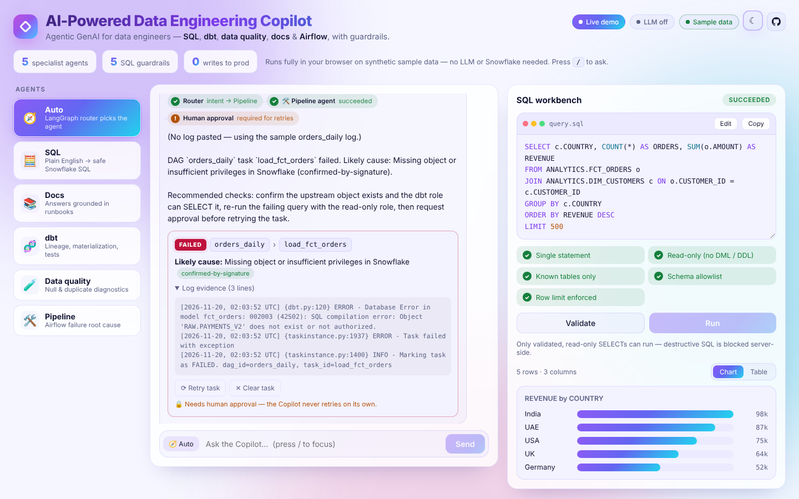
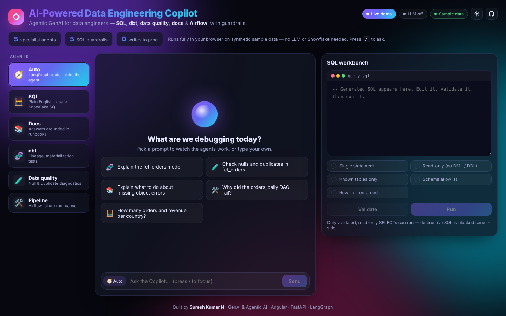
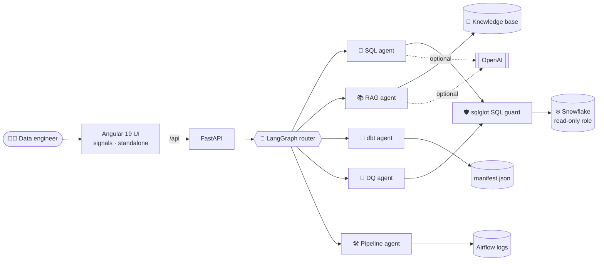

<div align="center">

<a href="https://sureshnarayananankumar.github.io/ai-powered-data-engineering-copilot/"></a>

<br/>

<a href="https://sureshnarayananankumar.github.io/ai-powered-data-engineering-copilot/"></a>
&nbsp;
<a href="#-quick-start"></a>

<br/><br/>


<br/>


<h3>Ask in plain English. Get grounded, explainable answers. Nothing touches production without a human.</h3>

<a href="https://sureshnarayananankumar.github.io/ai-powered-data-engineering-copilot/"></a>

<sub>👆 Click the GIF to open the live demo. It runs in your browser on synthetic data, so no keys are needed.</sub>

</div>

---

## ✨ What it does

<table>
<tr>
<td width="33%" valign="top">

### 🧮 SQL agent
Plain English → **Snowflake SQL** from real schema metadata. Shows **assumptions**, syntax-highlighted SQL, and a **live guardrail checklist** before you can press Run.

</td>
<td width="33%" valign="top">

### 📚 Docs (RAG) agent
Answers only from approved runbooks and **cites file › section**. If nothing relevant is found, it says *"I won't guess"* rather than hallucinating.

</td>
<td width="33%" valign="top">

### 🧬 dbt agent
Reads `manifest.json` for **materialization, upstream / downstream lineage and tests** of any model.

</td>
</tr>
<tr>
<td valign="top">

### 🧪 Data quality agent
Generates **read-only** null-count and duplicate-key diagnostics, validated by the same SQL guard, and loads them into the workbench in one click.

</td>
<td valign="top">

### 🛠️ Pipeline agent
Triage for failed **Airflow** tasks: finds the DAG/task, error evidence, and the likely cause (labelled *confirmed* vs *unknown*). Retry/clear are **locked behind human approval**.

</td>
<td valign="top">

### 🧭 LangGraph router
Classifies intent and routes to the right specialist. The UI shows each step as an **animated agent trace**: Router → Agent → Guard → Retrieval → Approval.

</td>
</tr>
</table>

## 🖼️ Screens

| Pipeline incident triage | Light theme |
|---|---|
|  |  |

<details>
<summary><b>More: welcome screen and SQL workbench with chart</b></summary>
<br/>




</details>

## 🏗️ Architecture



<details>
<summary><b>🔍 How a request flows (step by step)</b></summary>

1. **Route.** The LangGraph router classifies the message (or uses the agent you picked in the rail).
2. **Gather evidence.** The agent pulls only what it needs: schema, runbook passages, dbt manifest, or task logs.
3. **Propose.** The LLM (if configured) drafts SQL or an explanation. It *proposes*; it never executes.
4. **Guard.** Every SQL statement is parsed by `sqlglot`: single statement, read-only, known tables, schema allowlist, and an enforced row limit.
5. **Human in the loop.** Queries run only when **you** press Run. Retries and clears are never automated.
6. **Explain.** The answer comes back with sources, assumptions, and a confirmed / suspected label.

</details>

## 🛡️ Safety model

| Guardrail | How |
|---|---|
| Read-only SQL | `sqlglot` parse tree; DML/DDL (`INSERT`, `DROP`, `MERGE`…) rejected anywhere in the tree |
| No invented tables | Tables must exist in schema metadata and sit in an allow-listed schema |
| Bounded queries | `LIMIT` added or capped; statement timeout; least-privilege Snowflake role |
| Prompt-injection aware | Docs, logs and query results are treated as **data, never instructions** |
| Human approval | Run button is explicit; Airflow retry/clear is locked in the UI and not exposed by the API |
| No secrets in code | Everything comes from env vars; `.env` is git-ignored |

## 🚀 Quick start

**Backend** (Python 3.11+)

```bash
cd backend
python -m venv .venv && source .venv/bin/activate   # Windows: .venv\Scripts\activate
pip install -r requirements.txt
cp ../.env.example .env          # optional: OPENAI_API_KEY, Snowflake settings
pytest -q                        # ✅ 33 passed
uvicorn app.main:app --reload --port 8000           # API docs → http://localhost:8000/docs
```

**Frontend** (Node 20+)

```bash
cd frontend
npm install
npm start                        # http://localhost:4200 (proxies /api → :8000)
npx ng test --watch=false        # ✅ 8 SUCCESS
# Demo mode, no backend needed: http://localhost:4200/?demo=1
```

**Docker**

```bash
cp .env.example backend/.env
docker compose up --build        # UI → http://localhost:4200
```

## 🎮 Try these prompts

| Prompt | What you'll see |
|---|---|
| `Explain the fct_orders model` | dbt lineage, materialization and tests |
| `Check nulls and duplicates in fct_orders` | Read-only DQ SQL → load → Validate → guardrails turn green |
| `How many orders and revenue per country?` | SQL → Validate → Run → animated bar chart / table toggle |
| `Explain what to do about missing object errors` | Runbook answer with source chips |
| `Why did the orders_daily DAG fail?` | Incident card: DAG › task, log evidence, approval lock |

Keyboard: <kbd>/</kbd> focus the prompt · <kbd>Ctrl</kbd>+<kbd>Enter</kbd> run validated SQL · ☀/☾ theme toggle.

## 📦 What works today

| Feature | Status |
|---|---|
| LangGraph intent routing | ✅ tested |
| SQL guard (13 tests: DML/DDL, multi-statement, unknown tables, allowlist, row limit) | ✅ |
| dbt, DQ, RAG and pipeline agents on sample data | ✅ tested |
| Angular UI: agent rail, typing replies, agent trace, SQL highlighting, guardrail checklist, chart/table, themes | ✅ 8 unit tests |
| Live demo on GitHub Pages (in-browser demo backend via an Angular HTTP interceptor) | ✅ |
| SQL generation with OpenAI | ⚙️ needs `OPENAI_API_KEY` |
| Execution against Snowflake | ⚙️ needs credentials (Run stays disabled until configured) |

## 🗺️ Roadmap

- [ ] ChromaDB + embeddings for RAG
- [ ] LLM fallback for ambiguous intent routing
- [ ] Read-only Airflow REST client for live DAG status
- [ ] dbt run/test log explanations
- [ ] Streaming (SSE) responses
- [ ] Approval workflow for state-changing actions

<details>
<summary><b>📁 Project structure & API</b></summary>

```text
frontend/   Angular 19: app.component.*, core/copilot.service.ts, core/demo-backend.ts, core/demo.interceptor.ts
backend/    FastAPI: app/main.py, agents/ (router, graph, sql, rag, dbt, data_quality, pipeline), security/sql_guard.py
knowledge_base/sample_docs/   synthetic runbooks
sample_data/                  synthetic schema, dbt manifest, Airflow log
```

| Method | Path | Purpose |
|---|---|---|
| GET | `/api/health` | backend + integration status |
| POST | `/api/chat` | `{message, intent?, log?}` → routed agent response |
| GET | `/api/schema` | schema metadata |
| POST | `/api/sql/validate` | validate + normalize SQL |
| POST | `/api/sql/run` | execute validated read-only SQL |
| GET | `/api/samples/logs` | sample Airflow logs |

</details>

See [`SKILL.md`](SKILL.md) for the design guidelines this project follows.

---

<div align="center">

**Built by [Suresh Kumar N](https://github.com/sureshnarayananankumar)** · GenAI & Agentic AI Engineer · Angular / Front-end AI

⭐ If this was useful, a star helps others find it.

</div>
