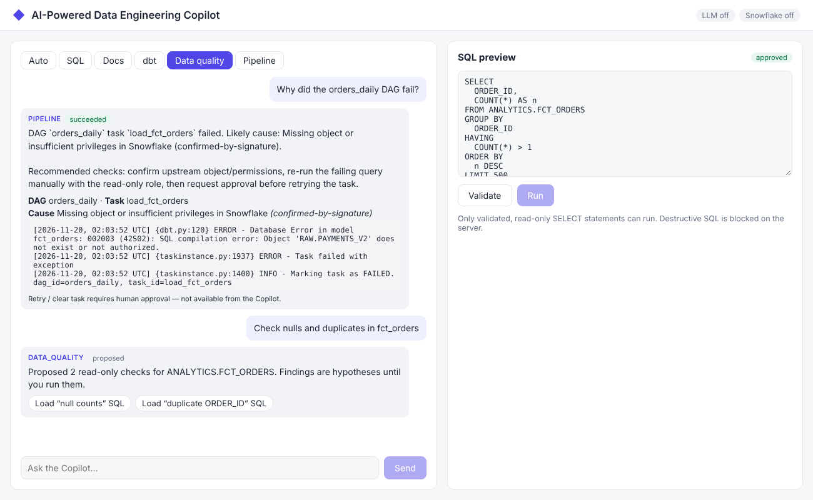

# AI-Powered Data Engineering Copilot

An agentic GenAI assistant for data engineers. Ask in plain English and get grounded, explainable help across **Snowflake SQL**, **dbt models**, **data quality**, **documentation (RAG)** and **Airflow incident diagnosis** — with safety guardrails so nothing changes production without a human.



**Stack:** Angular 19 · FastAPI · LangGraph · OpenAI · sqlglot SQL guard · Snowflake · dbt · Airflow · Docker · GitHub Actions

```text
Angular UI (standalone components + signals)
        │  /api (HttpClient, dev proxy)
        ▼
FastAPI backend
        │
        ▼
LangGraph router ──► SQL Agent ─────────► Snowflake (read-only role, SQL guard)
                 ├─► RAG Agent ─────────► knowledge_base/ (keyword retrieval → ChromaDB next)
                 ├─► dbt Agent ─────────► manifest.json lineage + tests
                 ├─► Data Quality Agent ► read-only null / duplicate checks
                 └─► Pipeline Agent ────► Airflow logs (signature-matched evidence)
```

## What works today (tested)

| Feature | Status |
|---|---|
| Intent routing via LangGraph | ✅ tested |
| SQL guard: blocks DML/DDL, multi-statements, unknown tables, non-allowlisted schemas; enforces row limit | ✅ 13 tests |
| dbt agent: materialization, upstream/downstream lineage, tests from `manifest.json` | ✅ tested on sample manifest |
| Data quality agent: generates validated read-only null & duplicate SQL | ✅ tested |
| RAG agent: answers with source file + section, refuses when nothing relevant is found | ✅ tested |
| Pipeline agent: extracts DAG/task, error evidence, likely cause (labelled confirmed/unknown); retries require human approval | ✅ tested on sample log |
| Angular UI: chat, mode tabs, sources, incident card, SQL preview → Validate → Run, results table, status chips | ✅ builds, 3 unit tests |
| SQL generation with OpenAI | ⚙️ needs `OPENAI_API_KEY` |
| Query execution in Snowflake | ⚙️ needs Snowflake credentials (Run stays disabled until configured) |

Everything runs offline on **synthetic sample data** (`sample_data/`, `knowledge_base/`).

## Quick start

### 1. Backend (Python 3.11+)

```bash
cd backend
python -m venv .venv && source .venv/bin/activate   # Windows: .venv\Scripts\activate
pip install -r requirements.txt
cp ../.env.example .env          # add OPENAI_API_KEY (optional) and Snowflake settings (optional)
pytest -q                        # expected: 33 passed
uvicorn app.main:app --reload --port 8000
```

API docs: http://localhost:8000/docs

### 2. Frontend (Node 20+)

```bash
cd frontend
npm install
npm start                        # http://localhost:4200, proxies /api to :8000
npx ng test --watch=false        # expected: 3 SUCCESS
```

### Or with Docker

```bash
cp .env.example backend/.env
docker compose up --build        # UI at http://localhost:4200
```

## Try these prompts

- `Explain the fct_orders model` → dbt lineage and tests
- `Check nulls and duplicates in fct_orders` → read-only DQ SQL you can load into the SQL preview
- `What should I do about missing object errors?` → runbook answer with sources
- Pipeline tab → **Load sample log** → `Why did the orders_daily DAG fail?`
- `How many orders per country last month?` → SQL generation (needs OpenAI key)

## Safety model

- The LLM only **proposes**. SQL runs only when the user clicks **Run**, and the backend re-validates it.
- `sql_guard.py` parses SQL with `sqlglot` — prompts are never relied on for safety.
- Least-privilege Snowflake role, schema allowlist, row limit and statement timeout.
- Documents, logs and query results are treated as **data, never instructions**.
- No retries, task clears, or schema changes from the Copilot — these are flagged as requiring human approval.
- Secrets come from environment variables only; `.env` is git-ignored.

## API

| Method | Path | Purpose |
|---|---|---|
| GET | `/api/health` | backend + integration status |
| POST | `/api/chat` | `{message, intent?, log?}` → routed agent response |
| GET | `/api/schema` | schema metadata (sample or Snowflake) |
| POST | `/api/sql/validate` | validate + normalize SQL |
| POST | `/api/sql/run` | execute validated read-only SQL |
| GET | `/api/samples/logs` | sample Airflow logs |

## Roadmap

- [ ] Milestone 3: ChromaDB + OpenAI embeddings for RAG
- [ ] LLM-based intent classifier fallback for ambiguous questions
- [ ] Airflow REST API client (read-only) for live DAG/task status
- [ ] dbt run/test log explanation
- [ ] Streaming responses (SSE) in the Angular chat
- [ ] Approval workflow UI for state-changing actions

See [`SKILL.md`](SKILL.md) for the full design guidelines used to build this project.

## Author

**Suresh Kumar N** — GenAI & Agentic AI Engineer · Angular / Front-end AI
